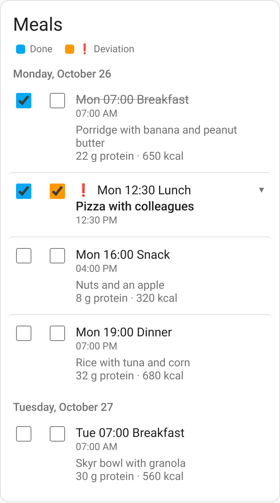
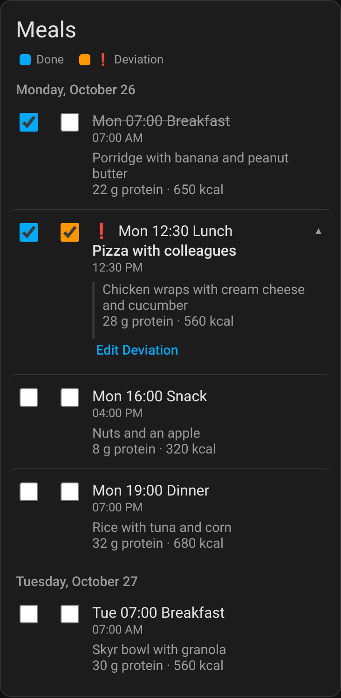
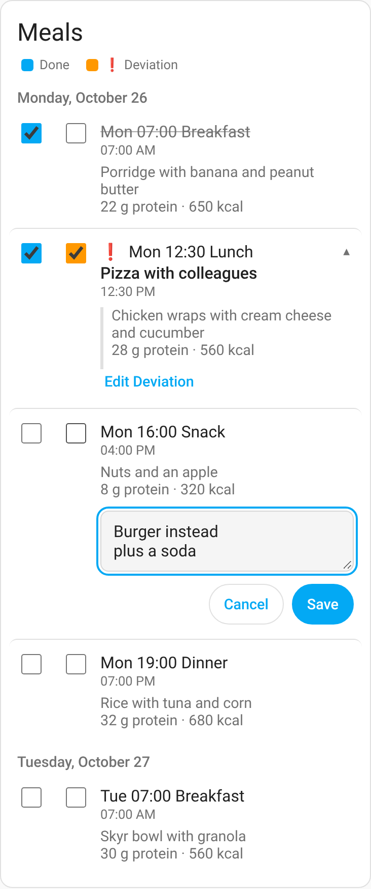
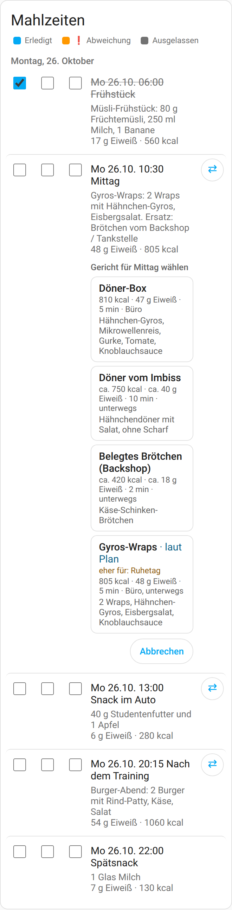
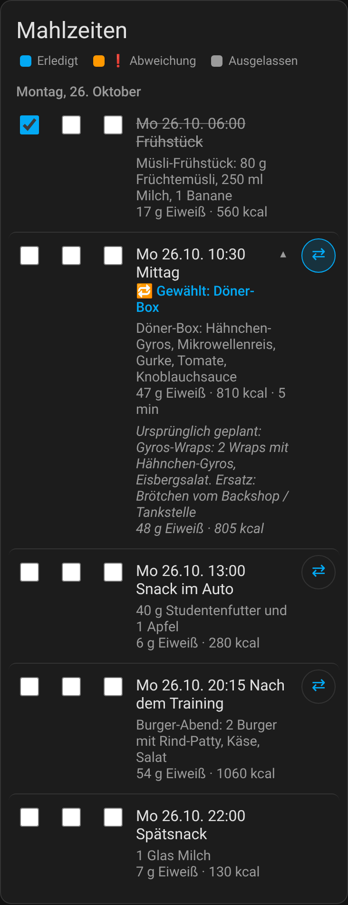
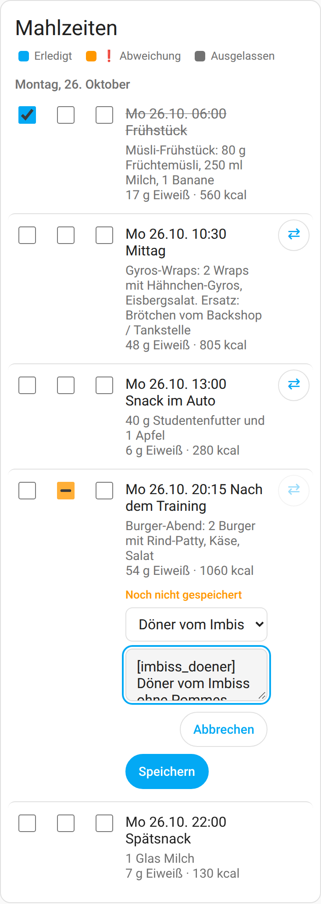

# Todo Annotate Card

A Home Assistant dashboard card for to-do lists that adds a **second checkbox** to every item.
Tick it to attach a short note, e.g. a *deviation* from a meal plan, a *problem* during a chore, or a *substitute* on a shopping list.
The note is merged into the item, the item is marked with ❗ (configurable) and shows only the note.
Tap the item to see the original description again.

[![hacs][hacs-badge]][hacs-url]  

*Deutsch: siehe [unten](#deutsch).*

| Light | Dark | Note editor |
|---|---|---|
|  |  |  |

| Pick another dish | Replanned | Note from the dish list |
|---|---|---|
|  |  |  |

## Features
- Two checkboxes per item: **Done** (the normal to-do status) and a configurable second one (label, icon, marker). Optional third checkbox **Skipped** (`skip: true`), off unless you turn it on.
- Inline note editor (single- or multi-line). Saving keeps the original description, appends one formatted line and can mark the item done. **The item summary is never changed**, so automations or scripts can keep using it as a key.
- A typed note is saved when you tap the note checkbox again, mark the item done, or open another item. Only **Cancel** drops the edit, and even then the text stays as a draft (in this browser, per list and item) until a successful save. While the editor is open the checkbox is indeterminate and shows “Not saved yet”.
- Annotated items show marker + note only; the original description expands on tap. Notes can be edited or removed (removing returns the item to normal).
- Works with any `todo.*` entity whose integration can edit descriptions (e.g. **Local To-do**). Lists without description support show a clear message.
- Live updates (`todo/item/subscribe`), writes via the `todo.update_item` action.
- Optional dish catalog (`dishes_entity`): swap a meal for another dish that fits the slot (⇄ button), or pick the dish you actually ate as the note. The original plan is kept and can be restored.
- Sorting, grouping by due day, hide or separate completed items, compact mode.
- Visual editor, English and German (follows your Home Assistant language), theme colours and dark mode, 44 px touch targets for the mobile app, keyboard and screen reader support.
- No external runtime dependencies, no CDN, one small JS file. All text is rendered as text (no HTML injection).

## Installation

### HACS (custom repository)
1. HACS → ⋮ → **Custom repositories** → add `https://github.com/LuFuhrmann/todo-annotate-card`, category **Dashboard**.
2. Search for **Todo Annotate Card**, download it.
3. Reload the browser (in the Companion app: Settings → Companion app → Debugging → *Reset frontend cache*).

HACS adds the dashboard resource automatically.

### Manual
1. Download `todo-annotate-card.js` from the [latest release](https://github.com/LuFuhrmann/todo-annotate-card/releases) (or `dist/`).
2. Copy it to `/config/www/todo-annotate-card.js`.
3. Settings → Dashboards → ⋮ → **Resources** → add `/local/todo-annotate-card.js?v=1.2.1`, type **JavaScript module**. Increase `?v=` after every update.

## Configuration
Add the card from the card picker (**Todo Annotate Card**) or use YAML:

```yaml
type: custom:todo-annotate-card
entity: todo.meal_plan
```

| Option | Type | Default | Description |
|---|---|---|---|
| `entity` | string | **required** | A `todo.*` entity. |
| `title` | string | entity name | Card title. Set `""` to hide. |
| `annotation_label` | string | `Note` / `Anmerkung` | Label of the second checkbox (legend, ARIA, buttons). |
| `annotation_icon` | string | `mdi:alert-circle-outline` | Icon next to the second checkbox when the legend is hidden. |
| `marker` | string | `❗` | Shown in front of annotated items. `""` for none. |
| `format` | string | `❗ Abweichung: {text}` | Line stored in the description. Must contain `{text}` once and no line break. |
| `separator` | string | `" / "` | Joins lines of multi-line input in the stored line. |
| `auto_complete` | bool | `true` | Saving a note marks the item done. |
| `on_remove` | `keep` \| `reopen` | `keep` | Status after removing a note. |
| `multiline` | bool | `true` | Textarea (Ctrl/⌘+Enter saves) instead of a single-line field (Enter saves). |
| `show_completed` | bool | `true` | Show completed items. |
| `completed_section` | bool | `false` | Put completed items into their own section at the bottom. |
| `sort` | `manual` \| `alpha` \| `due` \| `annotated_first` | `manual` | Sort order (`manual` = order of the list). |
| `group_by` | `none` \| `due_day` | `none` | Group items by the day they are due. |
| `description` | `always` \| `collapsed` \| `hidden` | `always` | Description of items *without* a note. Annotated items always show the note and reveal the description on tap. |
| `show_due` | bool | `true` | Show due date/time. |
| `show_header` | bool | `true` | Show the legend explaining the checkboxes. |
| `compact` | bool | `false` | Denser layout. |
| `skip` | bool | `false` | Third checkbox. Off leaves existing cards unchanged. |
| `skip_label` | string | `Skipped` / `Ausgelassen` | Label of the third checkbox (legend, ARIA, hint). |
| `skip_format` | string | `⊘ Skipped` or `⊘ Ausgelassen` | Line stored in the description. Depends on the Home Assistant language when unset. If it contains `{text}` once, the card asks for a reason. |
| `dishes_entity` | string | `""` (off) | Entity whose attributes hold a dish catalog (see [Dish catalog](#dish-catalog)). Empty turns all dish features off. |
| `dish_slot_pattern` | string | `^\S+\s+\S+\s+\d{1,2}:\d{2}\s+(.+)$` | Regular expression applied to the item summary; group 1 is the slot (e.g. `Mi 28.10. 10:30 Mittag` → `Mittag`). Invalid patterns fall back to the default. |
| `replan` | bool | `true` | Show the ⇄ button to swap an open item for another dish of the same slot. |
| `replan_label` | string | `Change dish` / `Umplanen` | Label of the ⇄ button (tooltip, ARIA). |
| `dish_in_note` | bool | `true` | Show a dish list above the note field. Free text stays possible. |

### Examples
Meal plan with deviations, grouped by day (German UI):
```yaml
type: custom:todo-annotate-card
entity: todo.essensplan_woche
title: Mahlzeiten
annotation_label: Abweichung
group_by: due_day
show_due: false
```

Chores with a “problem” note, open items only:
```yaml
type: custom:todo-annotate-card
entity: todo.chores
annotation_label: Problem
marker: "⚠️"
format: "⚠️ Problem: {text}"
show_completed: false
sort: due
```

Meal plan that can mark a slot skipped (German storage line, with a reason):
```yaml
type: custom:todo-annotate-card
entity: todo.meal_plan
skip: true
skip_label: Ausgelassen
skip_format: "⊘ Ausgelassen: {text}"
```

Without `{text}` the line is only a flag. Set `skip_format` explicitly if another tool reads the description; otherwise a German UI stores `⊘ Ausgelassen` and an English UI stores `⊘ Skipped`.

Shopping list with substitutes, notes do not tick the item:
```yaml
type: custom:todo-annotate-card
entity: todo.shopping_list_local
annotation_label: Substitute
marker: "🔁"
format: "🔁 Substitute: {text}"
auto_complete: false
multiline: false
description: hidden
```

## How notes are stored
The note is one line inside the item description, built from `format`:

```
Porridge with banana            ← original description (kept)
22 g protein · 650 kcal
❗ Abweichung: Pizza with colleagues / plus a soda
```

- Exactly one note line per item; saving again replaces it, removing deletes it.
- Parsing tolerates extra whitespace and CRLF; the last matching line wins.
- Because it is plain text, the note stays visible in the standard to-do card, the mobile app and in automations (`todo.get_items`). Other tools can parse it with the same pattern, e.g. Python: `re.match(r"^\s*❗\s*Abweichung\s*:\s*(.*)$", line)`.
- Changing `format` later does not convert existing notes. Keep it stable if other tools read the notes.

### Skipped items
Skipped is a separate line. The summary is still not changed, and the item is marked done. The note line and the skip line are mutually exclusive: setting one removes the other (the card asks first when a note would be deleted). Unchecking **Skipped** leaves the item done. Unchecking **Done** removes the skip line and marks the item not done.

Default lines (only when `skip_format` is unset):

| UI language | Line |
|---|---|
| German | `⊘ Ausgelassen` |
| English | `⊘ Skipped` |

With a reason, set `skip_format` to a template that contains `{text}` once, for example `⊘ Ausgelassen: {text}`. The stored line is then `⊘ Ausgelassen: keine Zeit`. Python:

```python
re.match(r"^\s*⊘\s*Ausgelassen\s*$", line)          # German default, no reason
re.match(r"^\s*⊘\s*Skipped\s*$", line)              # English default, no reason
re.match(r"^\s*⊘\s*Ausgelassen\s*:\s*(.*)\s*$", line)  # reason captured in group 1
```

On the card a skipped item shows `⊘` plus the name in grey, a “Skipped” hint (and the reason, if any). Tap it to see the original description, same as a note.

## Dish catalog
With `dishes_entity` set, the card reads a catalog from that entity's attributes. Any integration can provide it; a script can simply `POST /api/states/sensor.meal_dishes`. Attribute `dishes` (or `gerichte`) is a list:

```json
{
  "dishes": [
    {"id": "doener_box", "name": "Döner box with rice", "slots": ["Lunch", "Dinner"],
     "kcal": 810, "eiweiss_g": 47, "geschaetzt": true, "zeit_min": 5,
     "ort": ["at home", "office"], "tage": ["training"], "kurz": "Chicken gyros, rice, cucumber, tomato."}
  ],
  "punkte": {"Mi 28.10. 10:30 Lunch": {"gericht_id": "reis_box", "tag": "training"}}
}
```

- Required: `id` (`[A-Za-z0-9_.-]`, max. 64) and `name`. `slots` decides where a dish is offered; `kcal`, `eiweiss_g` (protein), `zeit_min`, `ort` (place, string or list) and `kurz` (short text) are shown when present; `geschaetzt: true` prefixes the values with “ca.”.
- Optional `punkte` maps an item summary to its planned dish (`gericht_id`) and day type (`tag`). Dishes whose `tage` contain the item's day type are listed first; the others are labelled “rather for: …”. Without `gericht_id` the planned dish is the catalog entry whose `name` equals the description text before the first `": "`.
- Home Assistant's recorder stores attributes only up to 16 KB. Larger catalogs still work on the card; exclude the entity from the recorder to avoid the warning.

### How a swapped dish is stored
Only the description changes; the summary stays the key.

```
🔁 Gewählt: Döner-Box mit Reis [doener_box]
Döner-Box mit Reis: Hähnchen-Gyros, Mikrowellenreis, Gurke, Tomate.
ca. 47 g Eiweiß · ca. 810 kcal · 5 min
↩ Plan: Reis-Box mit Schinken: Reis, Kochschinken, Erbsen ¶ 44 g Eiweiß · 735 kcal
```

- Line 1 marks the choice (`🔁 Chosen: … [id]` in English), line 2–3 are the new plan text, `↩ Plan:` (`↩ Planned:`) keeps the original description from the first swap, line breaks as ` ¶ `. **Back to the plan** restores it. Picking the planned dish on an unchanged item writes nothing.
- Note and skip lines (`❗ …`, `⊘ …`) stay below and work as before; a note on a swapped item is compared with the new plan.
- A dish picked as note is stored as `[id] Name` in front of the text, e.g. `❗ Abweichung: [imbiss_doener] Döner vom Imbiss / ohne Pommes`. The card hides the `[id]`.

```python
CHOICE = re.compile(r"^\s*🔁\s*(?:Gewählt|Chosen)\s*:\s*(.*?)\s*\[([A-Za-z0-9_.-]{1,64})\]\s*$")  # name, id
PLANNED = re.compile(r"^\s*↩\s*(?:Plan|Planned)\s*:\s*(.*)$")       # original, " ¶ " = line break
DISH_REF = re.compile(r"^\s*\[([A-Za-z0-9_.-]{1,64})\]\s*")          # at the start of a note
```

## Compatibility
- Home Assistant 2024.1 or newer (to-do item descriptions and `todo/item/subscribe`).
- Integrations: anything that supports *update item* and *set description* (e.g. Local To-do, CalDAV). Lists without description support (e.g. the classic Shopping list) show a message and the second checkbox is disabled.

## Accessibility
Native checkboxes with labels, `aria-expanded` on expandable items, visible focus rings, Escape closes the editor, Enter / Ctrl+Enter saves, colours from your theme.

## Development
```bash
npm ci
npm run typecheck
npm test               # unit tests (parsing/merging, sorting/grouping)
npm run build          # dist/todo-annotate-card.js
npm run screenshots    # headless render + interaction test with a mocked hass (needs Chrome/Chromium, CHROME_PATH)
```

## License
[MIT](LICENSE)

---

## Deutsch
**Todo Annotate Card** ergänzt jeden To-do-Punkt um eine **zweite Checkbox**, z. B. „Abweichung“.
Hakst du sie an, öffnet sich ein Eingabefeld. Nach dem Speichern wird der Punkt als erledigt markiert (abschaltbar), mit ❗ gekennzeichnet und zeigt nur noch deinen Text.
Die ursprüngliche Beschreibung erscheint erst, wenn du den Punkt antippst. Die Anmerkung kannst du bearbeiten oder entfernen; danach ist der Punkt wieder normal.

- Funktioniert mit jeder `todo.*`-Liste, die Beschreibungen bearbeiten kann (z. B. **Lokale To-do-Liste**).
- Gespeichert wird eine Zeile in der Beschreibung, Standard `❗ Abweichung: <Text>`. Der Name (summary) des Punkts wird **nie** geändert.
- Mehrzeilige Eingaben werden mit ` / ` zu einer Zeile verbunden.
- Tippt man die Anmerkung an, speichert sie auch, wenn die Checkbox erneut angetippt, der Punkt als erledigt markiert oder ein anderer Punkt geöffnet wird. Nur **Abbrechen** verwirft den Schreibvorgang; der Text bleibt als Entwurf erhalten und erscheint beim nächsten Öffnen wieder. Solange der Editor offen ist, ist die Checkbox unbestimmt und zeigt „Noch nicht gespeichert“.
- Optionale dritte Checkbox **Ausgelassen** (`skip: true`, standardmäßig aus). Speicherzeile ohne `skip_format` bei deutscher Oberfläche: `⊘ Ausgelassen`. Mit Grund z. B. `skip_format: "⊘ Ausgelassen: {text}"` → Zeile `⊘ Ausgelassen: keine Zeit`. Anmerkung und Ausgelassen schließen sich aus. Abhaken setzt den Punkt auf erledigt; das Häkchen bei Erledigt zu entfernen löscht die Ausgelassen-Zeile; nur Ausgelassen abwählen lässt den Punkt erledigt.
- Optionaler Gerichte-Katalog (`dishes_entity`, Attribut `gerichte` oder `dishes`, Format siehe [Dish catalog](#dish-catalog)): Über ⇄ **Umplanen** wählst du für einen offenen Punkt ein anderes Gericht aus dem passenden Slot (Slot = Teil der Bezeichnung nach der Uhrzeit, anpassbar über `dish_slot_pattern`). Gespeichert wird `🔁 Gewählt: Name [id]`, der neue Plantext und `↩ Plan: <ursprünglicher Plan>`; **Zurück zum Plan** stellt ihn wieder her. Im Abweichungs-Editor gibt es eine Gerichteliste (`dish_in_note`), Freitext bleibt möglich; gespeichert als `❗ Abweichung: [id] Name / Text`. Gerichte, die zum Tagtyp passen (`tage` im Katalog, `tag` in `punkte`), stehen oben.
- Oberfläche auf Deutsch oder Englisch, je nach HA-Sprache; visueller Karten-Editor; hell/dunkel; gut bedienbar in der HA-App am Handy.

Installation: HACS → ⋮ → *Benutzerdefinierte Repositories* → Repository-URL, Kategorie **Dashboard** → herunterladen. Manuell: Datei nach `/config/www/` kopieren und unter *Einstellungen → Dashboards → Ressourcen* als `/local/todo-annotate-card.js?v=1.2.1` (JavaScript-Modul) eintragen.

[hacs-badge]: https://img.shields.io/badge/HACS-Custom-41BDF5.svg
[hacs-url]: https://hacs.xyz/docs/faq/custom_repositories
